<!-- SPDX-FileCopyrightText: 2026 Jeremy Martinon -->
<!-- SPDX-License-Identifier: GPL-3.0-or-later -->

# Theory and conventions

## The Lorentzian EPRL vertex

Consider a four-simplex with boundary tetrahedra labeled $a=1,\ldots,5$. A spin $j_{ab}$ labels each shared triangle, and an intertwiner $i_a$ labels a chosen recoupling basis at tetrahedron $a$. The Lorentzian EPRL vertex is a multilinear function of these five boundary intertwiners. Its foundational construction at finite Barbero–Immirzi parameter $\gamma$ is due to [Engle, Livine, Pereira, and Rovelli, *LQG vertex with finite Immirzi parameter*](https://arxiv.org/abs/0711.0146).

The booster decomposition separates its Lorentzian representation theory into SU(2) recoupling symbols and four-valent booster functions. Gauge fixing at tetrahedron 1 removes one redundant Lorentzian group integration, so four boosters remain. The construction is developed in [Speziale, *Boosting Wigner's nj-symbols*](https://arxiv.org/abs/1609.01632). A graphical derivation of the vertex and its booster decomposition is given by [Donà and Frisoni, *How-To compute EPRL spin foam amplitudes*](https://arxiv.org/abs/2202.04360).

<figure id="vertex-booster-figure" class="theory-figure" markdown="1">

<figcaption markdown="1">
**Figure 1. The vertex in the booster decomposition.** The central SU(2)
network contains the boundary intertwiner $i_1$ and the summed intertwiners
$k_2,\ldots,k_5$. The four surrounding booster diagrams connect $k_a$ to
$i_a$ for $a=2,3,4,5$. Gauge-fixed tetrahedron 1, at the upper left, has no booster:
its links retain $j_{12},j_{13},j_{14},j_{15}$, while the other six links
carry $\ell_{ab}$. The drawing shows connectivity and recoupling pairs; the
ordered conventions are specified in the table below. Rendered from TikZ drawing, following the graphical presentation in
[Donà and Frisoni](https://arxiv.org/abs/2202.04360).
</figcaption>

</figure>

## Simplicity constraints and the two Y-maps

We denote the SL(2,$\mathbb C$) principal-series representation labels by $(\rho,k)$, with $\rho\in\mathbb R$ and $k$ a half-integer. The library supports **two simplicity prescriptions**, which assign these labels to each boundary spin:

$$
\begin{aligned}
\text{Usual prescription (default):}\qquad
&(\rho_{ab},k_{ab})=(\gamma j_{ab},j_{ab}),\\[4pt]
\text{Shifted prescription:}\qquad
&(\rho_{ab},k_{ab})=(\gamma(j_{ab}+1),j_{ab}).
\end{aligned}
$$

In both cases the Y-map embeds the boundary SU(2) spin $j_{ab}$ into the lowest SU(2) subspace of the selected SL(2,$\mathbb C$) representation. The prescription fixes the Lorentzian labels used throughout the booster computation and therefore the vertex being evaluated. Both prescriptions are supported for fixed, full-tensor, and coherent amplitudes.

The shifted choice is also the convention used in [Gozzini's `sl2cfoam-next` paper](https://arxiv.org/abs/2107.13952), which cites [Alexandrov](https://arxiv.org/abs/1004.2260) and [Ding and Rovelli](https://arxiv.org/abs/0911.0543) in its discussion of weakly imposing the linear simplicity constraints. Alexandrov derives the shifted Lorentzian restriction explicitly; Ding and Rovelli develop the weak-constraint construction in the Euclidean theory. See [the simplicity references](references.md#simplicity-constraints-and-y-map) for their respective roles.

The link label $k_{ab}$ in $(\rho_{ab},k_{ab})$ is an SL(2,$\mathbb C$) representation label. The single-node labels $k_a$ used below are instead SU(2) intertwiners summed in the booster decomposition. The subscripts distinguish these two conventional uses of $k$.

## Doubled labels and recoupling channels

All angular momenta in the equations on this page are ordinary spins. In memory, a half-integer $j$ is represented by the integer $J=2j$. This makes admissibility exact at the level of integer arithmetic:

$$
|J_1-J_2|\le J_3\le J_1+J_2,
\qquad J_1+J_2+J_3\equiv0\pmod2.
$$

A four-valent intertwiner coupling $(j_a,j_b)$ and $(j_c,j_d)$ has doubled labels

$$
I=I_{\min},I_{\min}+2,\ldots,I_{\max},
$$

$$
I_{\min}=\max(|J_a-J_b|,|J_c-J_d|),\qquad
I_{\max}=\min(J_a+J_b,J_c+J_d),
$$

provided the two pair sums have equal parity and the interval is nonempty. Thus the length of an intertwiner axis counts admissible representations; it is not the numerical value of its largest label.

The five channel pairings are

| Tetrahedron | First pair | Second pair |
| --- | --- | --- |
| 1 | $(j_{12},j_{13})$ | $(j_{14},j_{15})$ |
| 2 | $(j_{23},j_{24})$ | $(j_{25},j_{12})$ |
| 3 | $(j_{34},j_{35})$ | $(j_{13},j_{23})$ |
| 4 | $(j_{45},j_{14})$ | $(j_{24},j_{34})$ |
| 5 | $(j_{15},j_{25})$ | $(j_{35},j_{45})$ |

The full vertex and the coherent coefficients use these compatible bases. A change of pairing generally mixes intertwiner components through a Racah transformation. An equal numerical label in another pairing does not identify the same basis vector. Spin and normal permutations must therefore be kept together when constructing coherent boundary data.

## Truncating the virtual spins

The six spins joining tetrahedra 2 through 5 are extended beyond their boundary values:

$$
\mathcal E=\{23,24,25,34,35,45\},\qquad
\ell_{ab}\in\{j_{ab},j_{ab}+1,j_{ab}+2,\ldots\}.
$$

The infinite amplitude sums over all these virtual spins. The numerical amplitude instead uses a common cutoff:

$$
\ell_{ab}\in\{j_{ab},j_{ab}+1,\ldots,j_{ab}+\Delta\ell\}
\qquad\text{for every }ab\in\mathcal E.
$$

This is a six-dimensional box, with $(\Delta\ell+1)^6$ candidate shell combinations before admissibility pruning: each virtual spin has its own upper bound. The four links incident on gauge-fixed tetrahedron 1 retain their boundary spins.

The cutoff counts ordinary-spin increments. In memory, the doubled virtual labels therefore run over

$$
L_{ab}\in\{J_{ab},J_{ab}+2,\ldots,J_{ab}+2\Delta\ell\}.
$$

At $\Delta\ell=0$, all virtual spins equal their boundary values, but the internal intertwiner and recoupling sums remain.

## Factorization into a tensor network

The SU(2) 15j factor can be expressed as a sum over an additional recoupling spin $x$ of a product of five 6j symbols. Let $S_A,\ldots,S_E$ denote their weighted tensor representations, including the dimension and phase factors used in the implementation. With fixed boundary-spin arguments suppressed, the network is

$$
\begin{aligned}
A_{i_1i_2i_3i_4i_5}(\Delta\ell)
={}&\sum_{\substack{\{\ell_{ab}\}_{ab\in\mathcal E}\\
j_{ab}\le\ell_{ab}\le j_{ab}+\Delta\ell}}
\sum_{k_2,k_3,k_4,k_5,x}\\
&\times
S_A(x,i_1,k_5,\ell_{25})
S_B(x,k_5,k_4,\ell_{35},\ell_{45})\\
&\times S_C(x,k_3,k_4,\ell_{24},\ell_{34},\ell_{35})
S_D(x,k_3,k_2,\ell_{23},\ell_{24})\\
&\times S_E(x,i_1,k_2,\ell_{25})\\
&\times B^{(2)}_{i_2,k_2,\ell_{23},\ell_{24},\ell_{25}}
B^{(3)}_{i_3,k_3,\ell_{34},\ell_{35},\ell_{23}}\\
&\times B^{(4)}_{i_4,k_4,\ell_{45},\ell_{24},\ell_{34}}
B^{(5)}_{i_5,k_5,\ell_{25},\ell_{35},\ell_{45}}.
\end{aligned}
$$

$B^{(a)}$ identifies the tetrahedron; each is a four-valent $B_4$ function. The internal $k_2,\ldots,k_5$ are SU(2) recoupling channels. A second virtual discrete label occurs inside the spectral representation of each booster; it is not one of these external contraction indices.

<figure id="vertex-network-figure" class="theory-figure" markdown="1">

<figcaption markdown="1">
**Figure 2. The full rank-five tensor network.** Green nodes are the weighted
6j tensors $S_A,\ldots,S_E$; blue nodes are the boosters
$B^{(2)},\ldots,B^{(5)}$. Filled labeled junctions represent shared indices.
Line crossings without a junction do not connect. The dashed legs carry
the five open boundary intertwiners: in particular, $i_1$ joins $S_A$,
$S_E$, and the output leg, and is not summed in the full tensor. All other
labeled indices are summed over their allowed ranges. Rendered from TikZ tensor-network drawing, with tensor names matched to the
equation above.
</figcaption>

</figure>

An index shared by more than two tensors forms a hyperedge. Here $x$ occurs in all five $S$ tensors; $\ell_{25}$, $\ell_{24}$, and $\ell_{35}$ each occur in four tensors. The indices $k_2,\ldots,k_5$ and $\ell_{23},\ell_{34},\ell_{45}$ each occur in three. Slicing $x$ and choosing contractions that retain the other shared indices until their final use are central to the computation. The five $i_a$ remain boundary indices of the full tensor.

The [contraction chapter](contractions.md) specifies the five bare 6j arrangements and how the weighted tensors enter the computational tree. Dimension factors already stored in these tensors must not be inserted a second time.

## Supports and exact structural pruning

A 6j symbol imposes four triangle conditions. The code intersects their intervals and parity restrictions to construct supports: channel lists, allowed ranges, and offsets for blocks that may contribute. The same supports restrict booster outputs and subsequent contractions.

Supported tensors are locally dense arrays associated with these admissible blocks. They avoid much of the empty space of a single tensor covering the full Cartesian index range. This differs from generic sparse-matrix storage: the numerical kernels still operate on regular local panels suitable for cache reuse and BLAS.

Triangle pruning removes contributions that are identically zero. It does not discard a nonzero value merely because it is small, nor does it guarantee that every stored value is nonzero. Admissible 6j symbols can vanish through cancellation, and some local rectangular blocks include entries that are not used.

Normalized Wigner recurrences produce complete symbol sequences. The Luscombe–Luban method uses nonlinear ratios near sequence endpoints and three-term recurrence through the interior, with normalization and phase fixing. This supplies reusable sequences without external Wigner tables or an independent special-function call for every tensor entry. The [Wigner chapter](wigner-symbols.md) develops this construction for 6j and 3j symbols, including GPU evaluation of the 6j inputs.

## Fixed, full, and coherent amplitudes

Fixing all five $i_a$ leaves a real scalar. Retaining every admissible combination produces a real rank-five tensor. Reflection-compatible data allow compact storage; otherwise the output remains rectangular. The representation changes storage and work, not the logical five-index amplitude.

For coherent boundary data, each tetrahedron $a$ carries four normals. Write its ordered spin–normal pairs as $(j_f, \vec{n}_f)$, $f=1,\ldots,4$, using the pairings above. The usual all-outgoing definition in [Donà, Fanizza, Sarno, and Speziale, Eqs. (9)–(10)](https://arxiv.org/abs/1903.12624), expressed in the library's orthonormal intertwiner basis, is

$$
C^{(a)}_i
=\sqrt{2i+1}\sum_{m_1,\ldots,m_4}
\begin{pmatrix}
j_1&j_2&j_3&j_4\\
m_1&m_2&m_3&m_4
\end{pmatrix}^{(i)}
\prod_{f=1}^{4}D^{(j_f)}_{m_fj_f}(\vec{n}_f).
$$

Here the four-legged Wigner symbol couples the first pair of spins to the second through $i$, and the coherent-state Wigner matrix uses the section

$$
D^{(j)}(\vec{n}(\theta,\phi))
=e^{-i\phi J_z}e^{-i\theta J_y}e^{i\phi J_z}.
$$

Here $J_y$ and $J_z$ are the spin-$j$ SU(2) generators.

With the same leg order, outgoing convention, and spinor phases, the relation to the paper's coefficient is $C^{(a)}_i=\sqrt{2i+1}\,c_i$. This factor normalizes the intertwiner basis; it does not normalize the projected coherent state. The library uses the supplied normals directly, without inserting antipodal maps or conjugations. The [coherent-state chapter](coherent-states.md#the-coefficient-being-evaluated) expands the four-legged symbol into two 3j symbols and explains its evaluation from spinors.

The five resulting vectors $C^{(1)},\ldots,C^{(5)}$, called `C1`, …, `C5`, give

$$
\mathcal A_C=\sum_{i_1,\ldots,i_5}
A_{i_1\ldots i_5}\prod_{a=1}^{5}C^{(a)}_{i_a}.
$$

This is a bilinear coefficient convention: no additional complex conjugation is inserted. The vectors are projections into the invariant subspace, and are not automatically normalized to unit norm.

Absorbing $C^{(2)},\ldots,C^{(5)}$ into their boosters eliminates four output legs before the large contraction. The remaining $C^{(1)}$ is associated with two 6j factors because its tetrahedron has no booster. The CPU and GPU handle that remaining sum at different points in their contraction trees.

## Approximation and numerical error

The returned amplitude is $A(\Delta\ell)$, without extrapolation to infinite cutoff. Shell truncation, fixed quadrature, finite-precision recurrence, and contraction summation contribute different numerical errors. Coherent C1 coefficient pruning, when enabled, adds a separate approximation. Its threshold is not a certified relative error on the final amplitude.

CPU/GPU agreement checks shared inputs and conventions across implementations. It does not independently establish cutoff or quadrature convergence. The bounded-sum formulation and the exact support rules should be distinguished from the numerical approximations used to evaluate their surviving terms.
