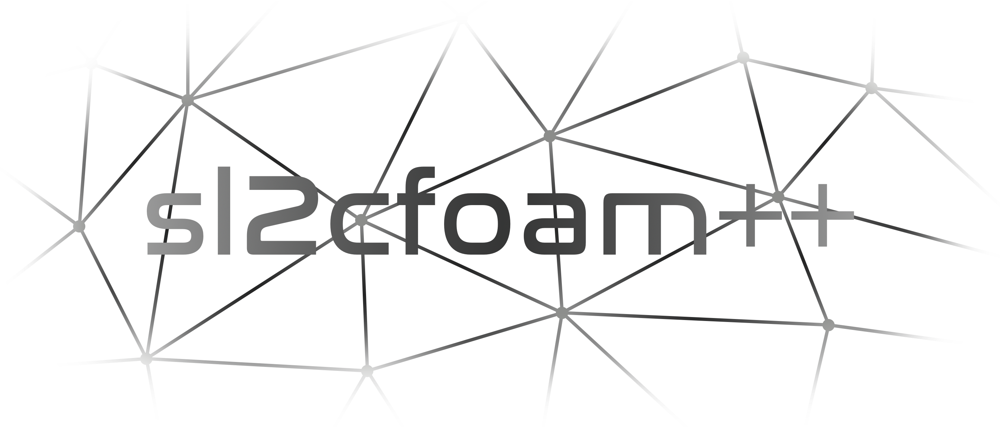

<!-- SPDX-FileCopyrightText: 2026 Jeremy Martinon -->
<!-- SPDX-License-Identifier: GPL-3.0-or-later -->

<p align="center">
  
</p>

# sl2cfoam++

[](https://github.com/JMartinon/sl2cfoamxx/actions/workflows/regression.yml)
[](https://github.com/JMartinon/sl2cfoamxx/actions/workflows/gpu-regression.yml)
[](https://jmartinon.github.io/sl2cfoamxx/)
[](LICENSE)

**sl2cfoam++ computes Lorentzian EPRL spin-foam vertex amplitudes for a
4-simplex, on CPUs and NVIDIA GPUs.** Developed as a C++ successor to
[sl2cfoam-next](https://github.com/qg-cpt-marseille/sl2cfoam-next), it evaluates
the Engle–Pereira–Rovelli–Livine model in an SU(2) intertwiner basis or with
Livine–Speziale coherent boundary states. Compute individual amplitudes or
full vertex tensors from C++, Python, Julia, or Mathematica.

[Installation](#installation) · [API guides](#choose-your-api) ·
[Configuration](docs/configuration.md) · [Scientific conventions](docs/scientific-conventions.md)

## Features

- Fixed-intertwiner amplitudes on CPU; coherent amplitudes and full tensors
  on CPU or GPU, with OpenMP host parallelism.
- Native multi-GPU contractions, plus independent batches using one process
  per GPU.
- One C++ numerical implementation shared by all four language APIs.
- Rank-five tensors with symmetry-aware storage, memory mapping, and portable
  files shared across languages.
- Native NumPy/einsum, Julia array, and Mathematica tensor operations.
- Coherent-state coefficients, closure checks, and CPU/GPU progress reporting.
- Seed-free Wigner recurrences, with no external Wigner library or symbol tables.

Public spins and intertwiners are **doubled integers**: `1` represents physical
spin `1/2`. See the [scientific conventions](docs/scientific-conventions.md)
for ordering, tensor indices, and numerical options.

## Performance

Representative benchmarks against `sl2cfoam-next`.<sup>[1](#benchmark-workstation)</sup>

All boundary spins are homogeneous with $j$=10, for the single-amplitude benchmark, all five intertwiners are $i$=20.

| Computation | Configuration | `sl2cfoam-next` | `sl2cfoam++` | Speedup |
|---|---|---:|---:|---:|
| **Single amplitude** | $j$=10, $i$=20, $\Delta\ell$=27 | 12 h 20 min | **518 ms** | **~85,000×** |
| **Full vertex tensor** | $j$=10, $\Delta\ell$=11 | 11 h 14 min | **41.2 s** | **~1000×** |
| **Coherent amplitude** | $j$=10, $\Delta\ell$=12 | 17 h 52 min | **738 ms** | **~87,000×** |

The single-amplitude comparison is **CPU vs CPU**. Full-tensor and coherent-amplitude results compare the CPU implementation of `sl2cfoam-next` with the **GPU backend** of `sl2cfoam++`.

<a name="benchmark-workstation"></a>
<sub>**1. Benchmark workstation:** AMD Ryzen 9 9950X3D2 Dual Edition · 64 GB DDR5 RAM · NVIDIA V100 32 GB GPU</sub>
## Requirements

| Component | Requirement |
| --- | --- |
| Platform | Linux or macOS |
| Build tools | CMake 3.22+; GNU C++ with C++20 and OpenMP support (GCC 13+ tested) |
| CPU linear algebra | Accelerate on macOS; LP64 CBLAS such as OpenBLAS, BLIS/AOCL, or MKL on Linux |
| GPU backend (optional) | All required when enabled: compatible CUDA toolkit, cuBLAS, and cuTENSOR |
| Python API (optional) | Python 3.10+ and development headers; NumPy for array operations |
| Julia API (optional) | Julia 1.10+ |
| Mathematica API (optional) | Licensed Wolfram installation with LibraryLink SDK |

Python builds download pinned nanobind into `third-party/` automatically.
Julia and Mathematica wrappers need no additional binding framework.

## Installation

From the repository root, choose an install prefix:
##### CPU
```sh
cmake -S . -B build -DCMAKE_INSTALL_PREFIX=/path/to/sl2cfoamxx-install
cmake --build build --parallel
cmake --install build
```

This builds the CPU library in **Release** mode by default. On macOS, install
GNU C++ with `brew install gcc`; CMake finds it automatically. On Linux, the
default C++ compiler must be GNU, or select one with `-DCMAKE_CXX_COMPILER=...`.
CPU tuning for the build machine is enabled by default. Use
`-DENABLE_NATIVE_ARCH=OFF` when building binaries for other CPU models.
**Tests and optional language wrappers are OFF by
default.** To enable a wrapper, add its switch from the table below. 

##### GPU
```sh
cmake -S . -B build-cuda \
  -DENABLE_CUDA=ON \
  -DCUDA_ARCHITECTURES=XX \
  -DCUTENSOR_ROOT=/path/to/cutensor \
  -DCMAKE_INSTALL_PREFIX=/path/to/sl2cfoamxx-install
cmake --build build-cuda --parallel
cmake --install build-cuda
```
With `CUDA_ARCHITECTURES=XX` being the GPU architecture (*e.g.*  80 for A100, 70 for V100), further details in [build guide](docs/building.md#nvidia-gpus).

The [build guide](docs/building.md) covers GPU/BLAS setup, all CMake option
defaults, troubleshooting, and opt-in integration tests.

## Choose your API

Each guide explains installation, a first calculation, tensors, and persistence.
The examples are runnable starting points for your own programs.

| API | Build switch | Guide | Example |
| --- | --- | --- | --- |
| C++ | Always built | [C++ API](docs/cpp-api.md) | [Basic calculation](examples/simple_example.cpp) · [Coherent boundary](examples/coherent_boundary_example.cpp) |
| Python | `SL2CFOAMXX_BUILD_PYTHON=ON` | [Python API](docs/python.md) | [All basics and optional einsum](examples/python_example.py) |
| Julia | `SL2CFOAMXX_BUILD_JULIA=ON` | [Julia API](docs/julia.md) | [All basics and array contractions](examples/julia_example.jl) |
| Mathematica | `SL2CFOAMXX_BUILD_MATHEMATICA=ON` | [Mathematica API](docs/mathematica.md) | [Complete notebook](examples/mathematica_example.nb) |

The technical library name is `sl2cfoamxx` in C++ includes, Python imports,
and CMake targets. Julia and Mathematica packages use `SL2CfoamXX`, following
a capitalized naming convention; they wrap the same library. Julia recommends
[CamelCase module names](https://docs.julialang.org/en/v1/manual/style-guide/#Use-naming-conventions-consistent-with-Julia-Base/).

## Further reading

- [Theory and algorithms](https://jmartinon.github.io/sl2cfoamxx/): booster recurrences, coherent
  states, tensor-network contractions, and the internal execution model.

- Runnable examples: [C++](examples/simple_example.cpp),
  [coherent C++](examples/coherent_boundary_example.cpp),
  [Python](examples/python_example.py), [Julia](examples/julia_example.jl),
  and [Mathematica](examples/mathematica_example.nb).
- [Configuration and defaults](docs/configuration.md): backends, threads,
  memory budgets, tensor storage, pruning, and progress.
- [Scientific conventions](docs/scientific-conventions.md): doubled labels,
  angle ordering, and tensor indexing across languages.
- [Regression testing](docs/testing.md): automated checks and how to run them.

## Citation

The scientific article accompanying **sl2cfoam++** is forthcoming. Its citation
will be added here when the publication details are available.

This placeholder is not a bibliographic record.
```bibtex
@article{sl2cfoamxx,
    author        = {Jeremy Martinon},
    title         = {sl2cfoam++: A new library for the computation of the EPRL spin-foam vertex amplitude.},
    year          = {2026},
    journal       = {TBD},
    eprint        = {TBD},
    archivePrefix = {arXiv},
    url = {https://github.com/JMartinon/sl2cfoamxx}
}
```

The machine-readable software citation and a template for the forthcoming
article's `preferred-citation` are maintained in [CITATION.cff](CITATION.cff).
The article citation will become the preferred citation once its details are
confirmed; a software-archive DOI can identify the exact release separately.

## License

**sl2cfoam++** is free software distributed under the terms of the **GNU General Public License v3.0 or later (GPL-3.0-or-later)**.

You may use, modify, and redistribute this software under the terms of the GPL. See [`LICENSE`](LICENSE) for the full license text.
